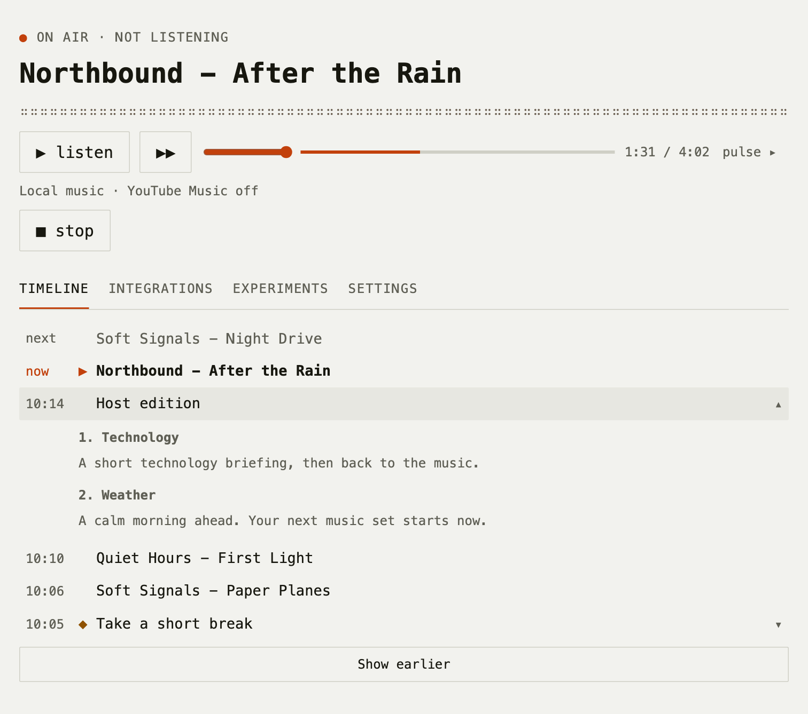

# Yourwave

```text
                  v
--|----|----|----|----|----|----|----|--
              YOURWAVE
        your music. your station.
```

`macOS` / `Python 3.11+` / [code: MIT](LICENSE) / [base audio: v1.0.0](https://github.com/ArtomStatsenko/yourwave/releases/tag/base-audio-v1.0.0)

[Quick start](#quick-start) / [Usage guide](docs/guide.md) / [Audio credits](assets/RIGHTS.md) / [Contribute](CONTRIBUTING.md)

Yourwave turns your music library into a local radio station, with a Russian-speaking host, short briefings, and useful reminders. Listen in your browser, see what just played, and shape the next edition without leaving the music.

Built for a single station on **macOS**, using Python, Liquidsoap, and FFmpeg. Speech and the default language model run locally; enabled integrations make network requests.

## Quick start

### 1. Set up the station

```sh
brew install python liquidsoap ffmpeg
git clone https://github.com/ArtomStatsenko/yourwave.git
cd yourwave
python3 tools/install_base_audio.py
mkdir -p ~/Music/Radio
```

Add your own MP3, M4A, FLAC, or WAV files to `~/Music/Radio`. The four Base sounds download separately with a pinned SHA-256; music and recordings stay outside Git. The Python application uses the standard library.

### 2. Connect speech and open the browser

Install **VoiceStudio** separately and set `voice.server_dir` in the generated configuration to its backend directory. The default speech endpoint is `http://127.0.0.1:3900`. For host links and GitHub summaries, run **Ollama** and download the default model:

```sh
ollama pull qwen3.5:4b
./bin/radio ui
```

The UI opens at [localhost:8765](http://127.0.0.1:8765/). Start the station, then choose **Listen**. Use `./bin/radio doctor` to check your tools and synthesize a voice sample.

Your existing data stays in `~/Library/Application Support/PersonalRadioClaude/`; the directory and `radio` command names are retained for compatibility. See the [setup and configuration guide](docs/guide.md#quick-start) for backend paths, offline audio installation, and a separate development environment.

> [!NOTE]
> VoiceStudio is not bundled. A complete first run on another machine has not yet been verified; [deployment status](docs/public-deployment-blockers.md) records the remaining checks.

## In the browser

<picture>
  <source media="(prefers-color-scheme: dark)" srcset="docs/images/yourwave-dark.png">
  
</picture>

*The repository's interface with demonstration data: current playback, the next track, and an expanded host edition. Light and dark themes follow your system.*

| Part of the station | What it does |
| --- | --- |
| Music | Local files or a connected YouTube Music playlist, with transitions between tracks |
| Host editions | Short news, weather, and music stories, scheduled around song boundaries |
| Timeline | Playback history and an optional editor for future editions and reminders |
| Reminders | Timed Todoist and iCal reminders, with original details kept in the timeline |

## Make it yours

- **Choose your sources:** GitHub, imported briefings, weather, calendar, Todoist, and optional integrations. [Integration setup](docs/guide.md#integrations).
- **Shape the sound:** switch between Base and a local Personal preset, set the station name, and adjust speech limits. [Settings](docs/guide.md#settings).
- **Control the broadcast:** use the browser or `./bin/radio` to pause, resume, skip, record, and inspect history. [Commands](docs/guide.md#commands).

## Development

Install Base and the audio tools, then run:

```sh
python3 -m unittest discover -s tests
git diff --check
```

The tests do not need VoiceStudio or an LLM; some use Liquidsoap and FFmpeg. See [CONTRIBUTING.md](CONTRIBUTING.md) for an isolated development setup and [TODO.md](TODO.md) for deferred work.

## License and audio

Code and documentation are [MIT](LICENSE). Base audio is edited from **Tech Live by Kevin MacLeod**, under **CC BY 4.0**, and distributed separately in [Releases](https://github.com/ArtomStatsenko/yourwave/releases/tag/base-audio-v1.0.0). Keep its attribution and descriptions of changes: [credits and rebuild instructions](assets/RIGHTS.md), [third-party notices](THIRD_PARTY_NOTICES.md).

Detailed usage documentation is in English. Some historical research and audio-audit documents under `docs/` are in Russian.
