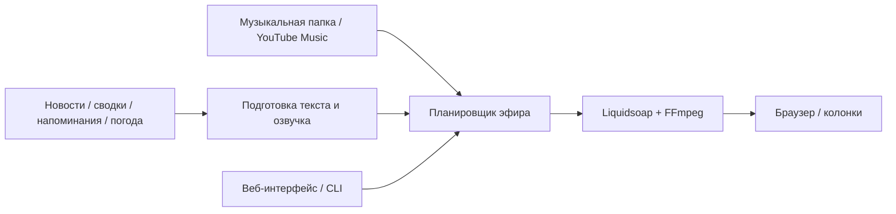

# Personal Radio

**Своя радиостанция: любимая музыка, короткие новости и ведущий на русском языке.**

Personal Radio собирает эфир из музыкальных сетов, джинглов, новостей и подводок. Ведущий объявляет песни, называет время и напоминает о событиях. Вы слушаете и управляете станцией через браузер; озвучка и языковая модель работают локально.

**macOS · Python 3.11+ · Liquidsoap · FFmpeg**

[Запуск](#быстрый-старт) · [Интеграции](#интеграции) · [Настройки](#настройки) · [Команды](#команды) · [Разработка](#разработка) · [MIT](LICENSE)

Проект рассчитан на локальный запуск на macOS; готового установщика в репозитории нет. В приватную поставку включён минимальный набор из четырёх служебных WAV; остальная музыка и джинглы остаются локальными. Для запуска нужны своя музыкальная библиотека и отдельно установленный голосовой backend. [Аудиокаталог](docs/audio.md) · [Блокеры публичного развёртывания](docs/public-deployment-blockers.md).

## Как звучит эфир

- **Музыка сетами.** Локальная библиотека или подключённый плейлист YouTube Music, переходы между песнями и позывные станции.
- **Новости небольшими выпусками.** Тренды GitHub, новые проекты и собственные готовые сводки. По умолчанию между выпусками — 20 минут музыки; первый выпуск приходит после одной песни.
- **Ведущий между треками.** Названия песен, время, анонс следующего сета, напоминания и погода. Продолжительность выпусков и общий бюджет речи регулируются.
- **Контроль в браузере.** Прослушивание, лента эфира, настройки и переключатели функций, интеграций и экспериментов.

В режиме прослушивания через браузер станция автоматически приостанавливает эфир, если слушателей нет 30 секунд, и возобновляет его при подключении.

## Быстрый старт

### 1. Установите инструменты

```sh
brew install python liquidsoap ffmpeg
git clone https://github.com/ArtomStatsenko/PersonalRadio.git
cd PersonalRadio
mkdir -p ~/Music/Radio
```

Положите песни в `~/Music/Radio`. Поддерживаются MP3, M4A, FLAC и WAV. Python-часть использует стандартную библиотеку; отдельный `pip install` для неё не нужен. Минимальная приватная поставка содержит вступление, подложку, концовку и разделитель; последний используется и для напоминаний. Отдельные позывные выключены по умолчанию, названия рубрик произносит ведущий.

### 2. Подготовьте голос и модель

| Компонент | Для чего нужен | Настройка по умолчанию |
| --- | --- | --- |
| VoiceStudio | Озвучка выпусков и ведущего | Сервер на `http://127.0.0.1:3900`, голос `default` |
| Ollama | Пересказ описаний GitHub и генерация подводок | `http://127.0.0.1:11434`, модель `qwen3.5:4b` |

VoiceStudio устанавливается отдельно. Радио умеет запускать его backend из каталога `voice.server_dir`; путь должен соответствовать вашей установке. Уже работающий сервер радио не останавливает.

Для установленной Ollama загрузите модель:

```sh
ollama pull qwen3.5:4b
```

Перед запуском убедитесь, что Ollama работает. Модель и адреса обоих серверов можно изменить в конфигурации. Готовые сводки читаются без пересказа языковой моделью.

### 3. Откройте станцию

```sh
./bin/radio ui
```

При первом запуске создаётся конфигурация с путями к четырём включённым WAV. Если голосовой backend установлен в другом месте, поправьте `voice.server_dir`. После успешного запуска откроется [интерфейс на localhost:8765](http://127.0.0.1:8765/); запустите эфир и включите прослушивание в браузере. При замене аудиопака настройте секцию `jingles` по [инструкции](docs/audio.md#роли-и-локальная-установка-аудиопака).

Для диагностики:

```sh
./bin/radio doctor
```

Команда проверяет аудиоинструменты, музыкальную папку и VoiceStudio, затем синтезирует тестовую фразу.

## Интеграции

| Интеграция | Что появляется в эфире | Как подключить |
| --- | --- | --- |
| GitHub Trending | Тренд дня и небольшие популярные проекты | Включено по умолчанию; параметры в `sources.github_trending` |
| Новые репозитории GitHub | Новые проекты за последнюю неделю | Включено по умолчанию; параметры в `sources.github_new` |
| Horizon | Новости из подготовленных брифингов Horizon | Установить Horizon отдельно, настроить `sources.horizon` и включить интеграцию |
| Календарь iCal | Напоминания перед событиями; ненавязчивые упоминания событий на весь день | Указать `reminders.calendar_url`; для событий на весь день включить Host links |
| Todoist | Напоминания о задачах с назначенным временем | Указать `reminders.todoist_token` |
| Open-Meteo | Короткий прогноз не чаще одного раза в три часа | Указать `weather.city`, например `Da Lat`, и включить Host links |
| YouTube Music | Музыка из подключённого плейлиста | Установить `yt-dlp`, подключить плейлист и cookies в интерфейсе, включить интеграцию и перезапустить эфир |

Для YouTube Music:

```sh
brew install yt-dlp
```

При недоступности источника предусмотрен возврат к локальной музыке. Cookies могут потребовать обновления; они хранятся в локальном каталоге данных.

**Эксперимент: ведущий поверх музыки.** Станция использует синхронизированные тексты LRCLIB, чтобы выбрать участки до начала и после окончания вокала. Если текста нет, часть выпусков завершается поверх начала следующей песни. Настройка находится в Experiments.

## Настройки

Основной файл создаётся автоматически:

```text
~/Library/Application Support/PersonalRadioClaude/config.toml
```

Имя каталога сохранено для совместимости. В файле задаются музыкальная папка, название станции, источники, голос и модель. Пример значений для соответствующих разделов существующего файла:

```toml
[music]
path = "~/Music/Radio"

[broadcast]
station_name = "Personal Radio"
music_set_minutes = 20
max_break_speech_sec = 120
max_spoken_seconds_per_rolling_hour = 300

[weather]
city = "Da Lat"
```

Числовые настройки эфира и переключатели сохраняются из интерфейса отдельно от `config.toml`. Большинство применяется без перезапуска; описание функции указывает, когда нужен новый запуск.

Другой каталог данных можно выбрать при запуске:

```sh
RADIO_DATA_DIR="$HOME/.personal-radio" ./bin/radio ui
```

Используйте одно и то же значение `RADIO_DATA_DIR` для интерфейса и CLI-команд этой станции.

### Данные и внешние сервисы

Конфигурация, токены, cookies, кэш аудио и история эфира находятся в каталоге данных вне репозитория. Секретная iCal-ссылка даёт доступ к календарю; храните её и cookies только локально.

Интерфейс слушает только `127.0.0.1`. Источники новостей, погода, календарь, Todoist, YouTube Music и LRCLIB используют сетевые запросы; локальные Ollama и VoiceStudio обрабатывают текст и голос на вашей машине при стандартной конфигурации.

## Команды

| Команда | Действие |
| --- | --- |
| `./bin/radio ui` | Открыть управление и прослушивание |
| `./bin/radio play` | Запустить эфир |
| `./bin/radio pause` / `./bin/radio resume` | Приостановить / продолжить |
| `./bin/radio next` | Перейти к следующему треку |
| `./bin/radio skip-news` | Пропустить новости |
| `./bin/radio stop` | Остановить станцию |
| `./bin/radio status` | Показать состояние |
| `./bin/radio history --last 20` | Показать последние выпуски |
| `./bin/radio source list` | Показать источники |
| `./bin/radio doctor` | Проверить окружение и голос |

Записать эфир при новом запуске:

```sh
./bin/radio play --record /tmp/personal-radio.wav
```

### Своя сводка

Импортируйте Markdown или JSON либо передайте текст из буфера обмена macOS:

```sh
./bin/radio import examples/test-digest.md --published-at "$(date +%Y-%m-%dT%H:%M:%S%z)"
./bin/radio paste --topic "Моя сводка" --published-at "$(date +%Y-%m-%dT%H:%M:%S%z)"
```

Дата выпуска должна содержать часовой пояс; сводки старше 24 часов не попадают в эфир. В примере текущая дата назначается проверочному тексту; для настоящих новостей указывайте фактическое время публикации. При импорте дата также может находиться в метаданных файла.

Радио удаляет разметку и ссылки из произносимого текста и делит длинную сводку на части, сохраняя её слова. Формат входящих файлов описан в [`radio/content.py`](radio/content.py).

## Как это устроено



| Каталог | Содержимое |
| --- | --- |
| [`radio/`](radio/) | Планировщик, интеграции, аудиотракт, CLI и веб-интерфейс |
| [`assets/`](assets/) | Аудиокаталог, настройки громкости и словарь произношения; сам аудиопак локальный |
| [`examples/`](examples/) | Пример сводки; локальные аудиопредпросмотры исключены из Git |
| [`tests/`](tests/) | Проверки логики и фикстуры |
| [`launcher/`](launcher/) | AppleScript для запуска на macOS |

## Разработка

```sh
python3 -m unittest discover -s tests
```

Часть тестов использует установленные аудиоинструменты и четыре служебных WAV из минимальной приватной поставки. Полноценная проверка эфира дополнительно требует работающего голосового backend и прослушивания результата.

Текущие отложенные задачи — в [`TODO.md`](TODO.md): подводки во время ожидания YouTube Music и изменение названия станции через интерфейс.

Правила работы с issues и PR, проверки и отдельное окружение для разработки — в [CONTRIBUTING.md](CONTRIBUTING.md).

## Лицензия

Исходный код и документация — [MIT](LICENSE). На четыре WAV в приватной поставке MIT не распространяется; разрешение на их публичную раздачу не подтверждено. Остальное аудио исключено из поставки: [THIRD_PARTY_NOTICES.md](THIRD_PARTY_NOTICES.md). Источники и решение по каждому файлу записаны в [аудиокаталоге](docs/audio.md).
