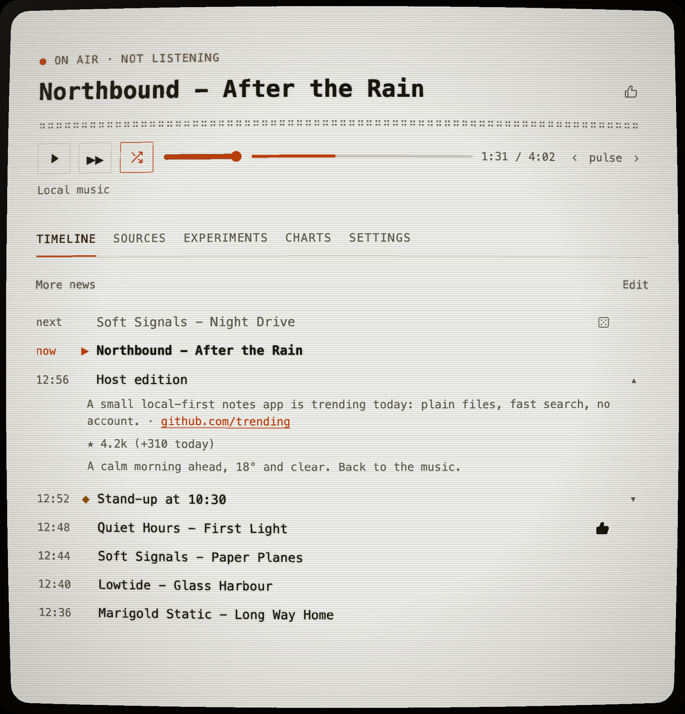
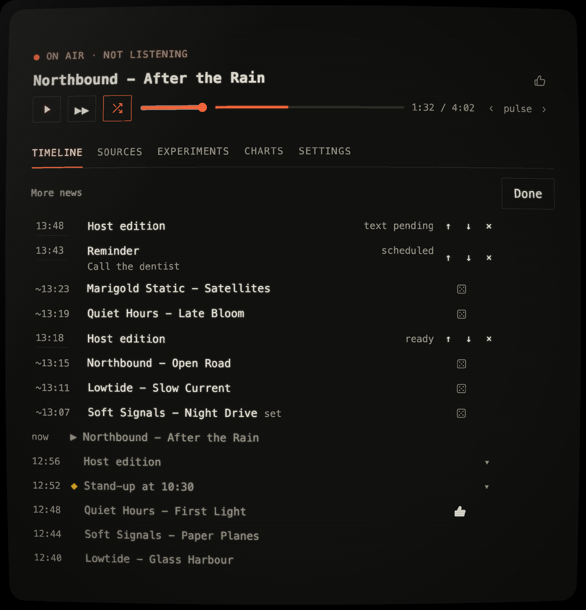
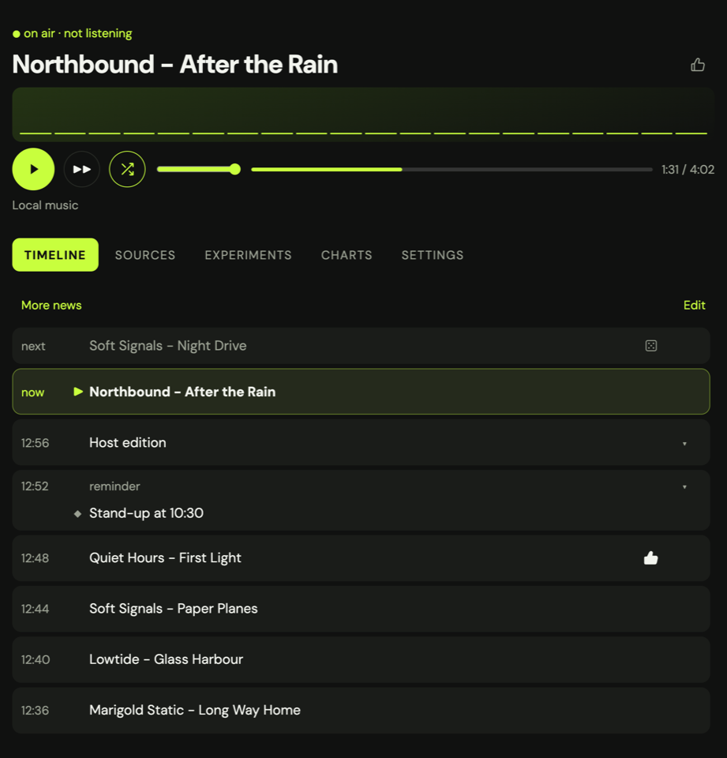
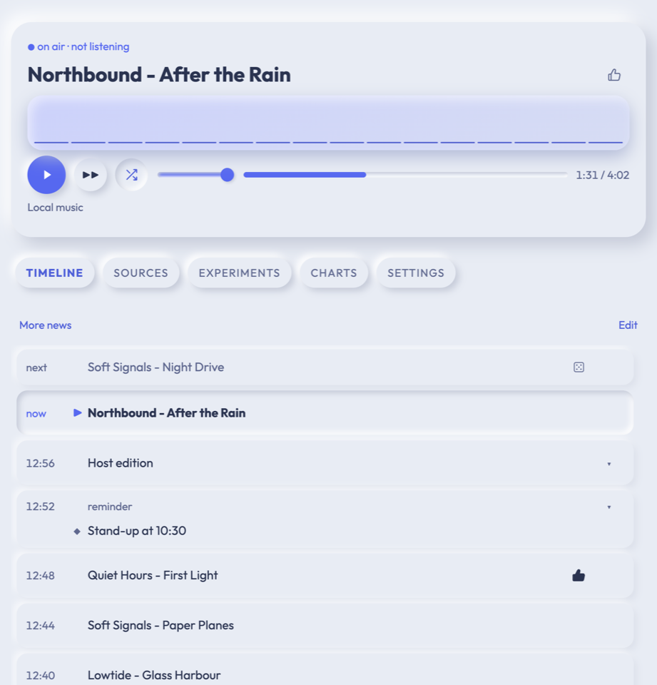
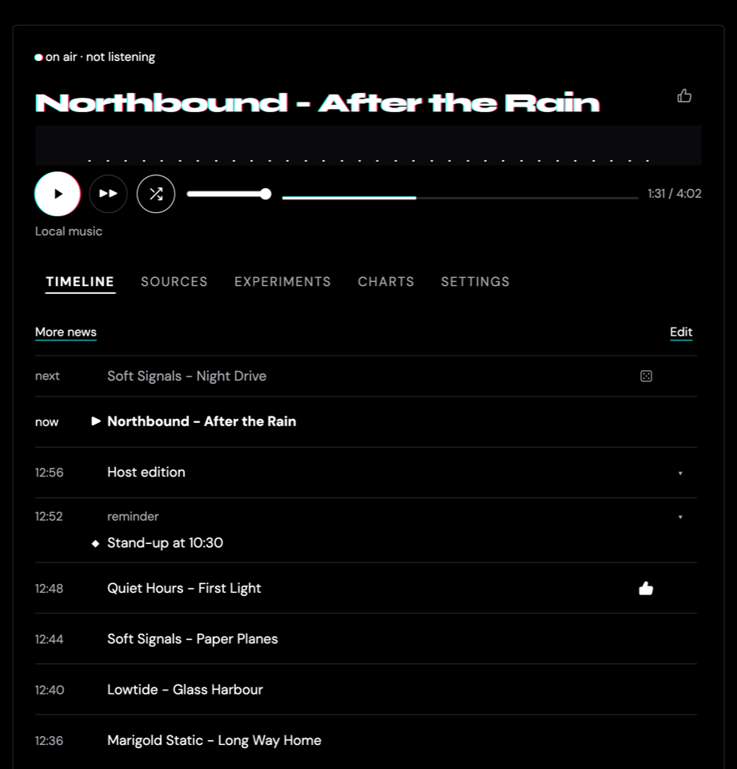
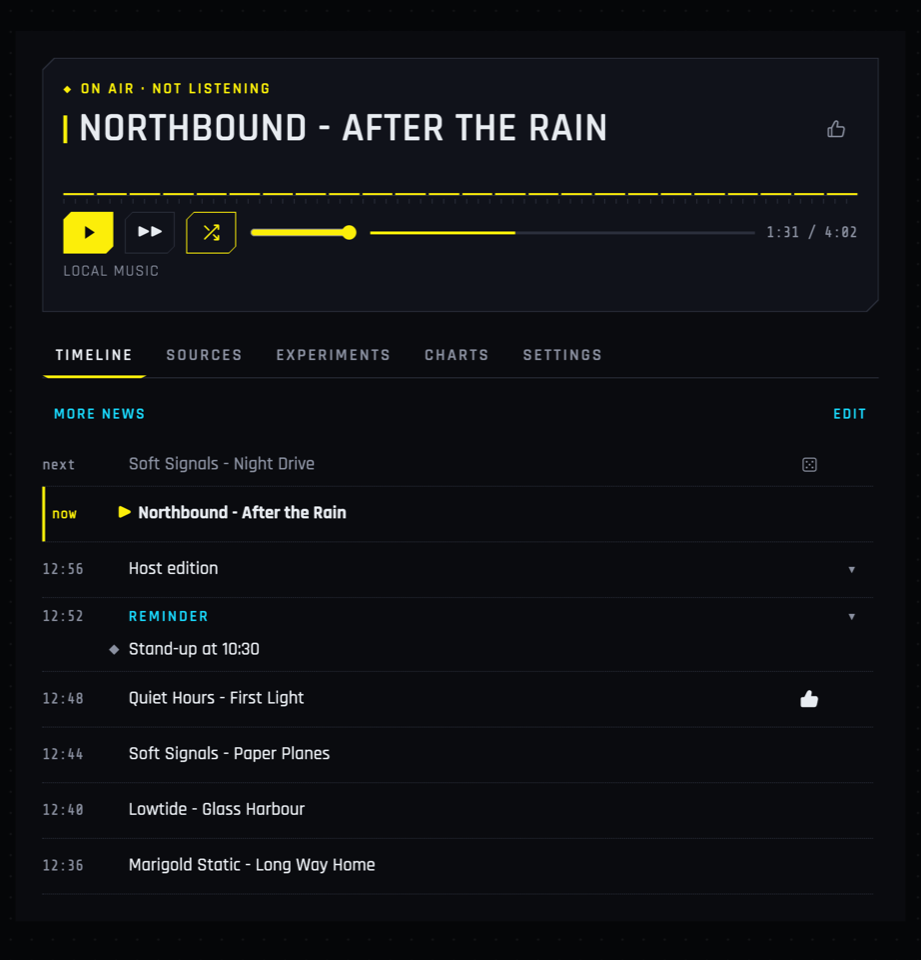

# Yourwave

**Your music. Short briefings. A station of your own.**

```text
──┬────┬────┬────▼────┬────┬────┬──
              YOURWAVE
```

`macOS` · `Python 3.11+` · `Liquidsoap` · `FFmpeg` · [MIT](LICENSE)

[Quick start](#quick-start) · [Themes](#five-looks-one-station) · [Integrations](#integrations) · [How it works](#how-it-works) · [Guide](docs/guide.md) · [Contributing](CONTRIBUTING.md)

Yourwave turns the music on your Mac into a personal radio station. Between songs, a Russian-speaking host reads short news editions from sources you choose, the weather, and your calendar and Todoist reminders. You listen in the browser, see what just aired, and change what comes next while the music plays.

<picture>
  <source media="(prefers-color-scheme: dark)" srcset="docs/images/yourwave-dark.png">
  
</picture>

<sub>Demo data. The terminal theme follows your system's light or dark mode.</sub>

- **Local first.** Speech and the default script editor (Ollama) run on your Mac. The Python app uses only the standard library: there is nothing to `pip install`.
- **A real broadcast.** Liquidsoap mixes the songs with crossfades and lowers the song under the host's voice. FFmpeg processes the voice and the whole station like a radio does: compression, a de-esser and a limiter.
- **Your sound.** Upload your own intro, outro, speech bed, separator, reminder sound or station ID in **Settings → Sounds**. A slot without your own files plays Base.
- **Yours to steer.** Use the dice to replace the next song, or, in the editor, any coming song; skip a block, move an edition, or insert your own text. The station has a CLI and an HTTP API for scripts and agents.

## Quick start

You need a Mac with [Homebrew](https://brew.sh), a folder of music, and about ten minutes.

**1. Install the station**

```sh
brew install python liquidsoap ffmpeg
git clone https://github.com/ArtomStatsenko/yourwave.git
cd yourwave
python3 tools/install_base_audio.py   # four Base sounds, checked against a pinned SHA-256
mkdir -p ~/Music/Radio                # put MP3, M4A, FLAC or WAV files here
```

**2. Add a voice and a script editor**

- Speech: install **VoiceStudio** separately. It is not bundled. By default the station expects it at `http://127.0.0.1:3900`.
- Script editor: install [Ollama](https://ollama.com) and pull the default model:

  ```sh
  ollama pull qwen3.5:4b
  ```

  If you prefer a cloud model, choose one later in **Settings**: OpenAI (a key or *Sign in with ChatGPT*), OpenRouter, DeepSeek or xAI Grok.

**3. Open your station**

```sh
./bin/radio ui
```

The page opens at [127.0.0.1:8775](http://127.0.0.1:8775/) and starts the station. On first launch it writes your `config.toml`. Press **▶** to listen.

**4. Check the setup**

```sh
./bin/radio doctor
```

`doctor` checks the tools, the audio output, your music folder and the voice backend, then speaks a Russian test phrase. If VoiceStudio is not in its default folder, set `voice.server_dir` in `config.toml`. The [setup guide](docs/guide.md#quick-start) covers backend paths, an offline install and every setting.

<details>
<summary>Where your station lives</summary>

Configuration, source connections, playback history and caches live in `~/Library/Application Support/PersonalRadioClaude/`. The older directory name and the `radio` command are kept for compatibility. Your music stays in the folder you choose.

To try changes on a separate development station, set `RADIO_DATA_DIR`; see [Contributing](CONTRIBUTING.md#setup).

</details>

> [!NOTE]
> A complete first run on a fresh machine has not yet been verified. The [deployment status](docs/public-deployment-blockers.md) lists the checks still open.

## On air

| | What your station does |
| --- | --- |
| **Music** | Your local files, a connected YouTube Music playlist, or both in one shuffle. Unheard songs can go first; the *Energy wave* experiment rises and eases with listening time. Songs you copy into the folder join without a restart. |
| **Host editions** | Main and short editions at `:00` and `:30`, placed at song boundaries. The host speaks over the end of a song, as on the radio. A second host is an experiment. |
| **Reminders** | Calendar events and Todoist tasks, read aloud ahead of time, with the details kept in the timeline. |
| **Timeline** | What aired, with an unfolded transcript and the source links for each edition, what airs next, and a 👍 for songs you want more often. |
| **Editor** | With the *Air direction* experiment on, the plan for the next hours: a dice on every coming song, skip or move a block, insert a text, a jingle or a weather update. |
| **Charts** | Weekly, monthly and all-time charts from your 👍 and your plays. With Air direction on, a *chart set* airs them. |
| **Anywhere** | The same page on your phone over a private [Tailscale](docs/mobile-listening.md) network. |

Edition times are estimates until the songs around them are fixed. If a source is down, the music keeps playing.

<p align="center">
  
</p>

<sub>The timeline editor (**Timeline → Edit**). Demo data.</sub>

## Five looks, one station

Every theme is the same page with a different look: the same timeline, editor and settings. Choose one in **Settings → Appearance**, open a theme with `?theme=<name>` in the page address, or set `[ui] theme` in `config.toml`.

<table>
  <tr>
    <td width="50%"><br><b>lime</b>: dark, one lime accent, rows as tiles</td>
    <td width="50%"><br><b>soft</b>: light, indigo, soft raised controls</td>
  </tr>
  <tr>
    <td><br><b>prism</b>: black, a split-colour title, thin lines</td>
    <td><br><b>cyber</b>: yellow on black, cut corners</td>
  </tr>
</table>

**terminal** (shown at the top) is the default and the reference. To write your own theme, see [Page themes](docs/ui-themes.md).

## Integrations

Everything except your music folder is optional. Turn sources on in the page's **Sources** tab or in `config.toml`. Setup for each one is in the [guide](docs/guide.md#integrations).

| Area | Integration | What it brings |
| --- | --- | --- |
| Music | Local folder | MP3, M4A, FLAC and WAV from `~/Music/Radio` |
| | YouTube Music | A connected playlist, played through `yt-dlp`, with local songs as the fallback |
| Speech | VoiceStudio | The host's voice, designed from a description (OmniVoice); a Qwen3-TTS voice-cloning engine is also supported |
| Script editor | Ollama · OpenAI / ChatGPT · OpenRouter · DeepSeek · xAI Grok | Short Russian retellings that follow one editorial policy for every source |
| News | GitHub Trending · new GitHub repositories | Popular projects, and promising projects from the last week |
| | Horizon | Prepared news briefings |
| | Reddit · Telegram | Public subreddits and channels you choose ([experimental](docs/public-news.md)) |
| Your day | iCal calendar · Todoist | Timed reminders and all-day mentions |
| | Open-Meteo | A short weather update, at most every three hours |
| About songs | LRCLIB · MusicBrainz · Wikidata | Lyrics timing, so the host does not talk over vocals, and verified *music stories* |
| Elsewhere | Tailscale | The station on your phone, privately ([how](docs/mobile-listening.md)) |
| Automation | HTTP API · CLI | Every station operation, with JSON output ([reference](docs/cli/README.md)) |

Optional integrations and cloud editors make network requests: for example, music stories send artist and track names to MusicBrainz and Wikidata. Tokens and cookies stay in your local data folder.

## How it works

```text
  news · calendar · weather · todos
                 │
           script editor    LLM: a short retelling
                 │
               voice        TTS
                 │
               daemon       plans the clock and the timeline
                 │
             Liquidsoap     songs, talk-ups, crossfades
                 │
               FFmpeg       voice and master processing
                 │
     browser · speakers · phone
```

- `radio/daemon.py` keeps the plan: what airs at the next song boundary and which edition fits the clock.
- `radio/radio.liq` is the Liquidsoap mixer. `radio/engine.py` drives it and runs the FFmpeg output chain.
- `radio/ui.py` serves the page and the stream. `radio/web` holds the page: one core, one model and five themes.

For the details, read the [audio chain](docs/audio.md), the [HTTP API](docs/api.md) and the [energy wave](docs/energy-wave.md).

## At the terminal

```sh
./bin/radio status              # what is on air
./bin/radio next                # skip to the next song
./bin/radio history --last 10   # what aired
```

For scripts and agents, the same operations come as JSON:

```sh
./bin/radio --json capabilities
./bin/radio --json queue list
./bin/radio --json probe --silent --seconds 5   # decode the live stream, no audio device
```

`./bin/radio api serve` runs the API without opening a browser. The [CLI and API reference](docs/cli/README.md) lists every operation, how to pass credentials on stdin, and the exit codes.

## Documentation

| Read | For |
| --- | --- |
| [Usage guide](docs/guide.md) | Setup, integrations, settings, commands |
| [Phone listening](docs/mobile-listening.md) | The station on your phone over Tailscale |
| [Audio](docs/audio.md) | Loudness, transitions, voice and master processing |
| [HTTP API](docs/api.md) · [CLI](docs/cli/README.md) | Automation and agents |
| [Page themes](docs/ui-themes.md) | How themes work, and how to write one |
| [Product](PRODUCT.md) · [Design](DESIGN.md) | What the station is for, and the interface rules |

## Development

```sh
python3 -m unittest discover -s tests
git diff --check
```

The tests need neither VoiceStudio nor an LLM. Some of them start Liquidsoap and FFmpeg. See [CONTRIBUTING.md](CONTRIBUTING.md) for an isolated development station and [TODO.md](TODO.md) for deferred work.

| Path | Contents |
| --- | --- |
| [radio/](radio/) | The station process, source adapters, speech, playback and the page |
| [tests/](tests/) | Scheduling, UI, state and audio-engine checks on isolated data |
| [tools/](tools/) | The Base audio installer and build tools |

## License and credits

- **Code and documentation:** [MIT](LICENSE).
- **Base sounds:** edited from **Tech Live by Kevin MacLeod**, under **CC BY 4.0**, and distributed separately as [Base audio v1.0.0](https://github.com/ArtomStatsenko/yourwave/releases/tag/base-audio-v1.0.0). See the [credits and rebuild instructions](assets/RIGHTS.md).
- **English pronunciation data:** the bundled CMUdict, under its [own license](assets/cmudict.LICENSE).

See the [third-party notices](THIRD_PARTY_NOTICES.md) for attribution and distribution limits. The usage documentation is in English. Some historical research and audio-audit notes under `docs/` are in Russian.
